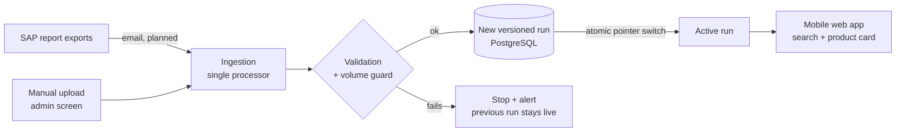

# Stock Lookup without SAP: Availability on the Phone

**Case study** of a mobile web app I designed and built for an industrial client. Sales staff type a product name on their phone and see current stock, incoming stock and how fresh the data is, without opening SAP.

> **About this repo.** The source code belongs to the client and stays private. This repository documents the problem, architecture, decisions and system metrics. The client is not named and no business data appears here.

**Status:** pilot, deployed and tested. Production starts once the client sets up the delivery of SAP report exports by email. Built with spec-driven development and Claude Code as the coding agent, under my design, review and approval.

---

## The problem

To check whether a product was available, a salesperson had to:

1. open a computer,
2. log in to SAP,
3. navigate to the inventory query,
4. read the stock.

None of those steps is possible in front of a customer, so the check was postponed or skipped. And when there was no stock, there was no easy way to see what was arriving and when, so the future sale was lost too.

**The problem was friction, not wrong data.** Success is measured by how fast a salesperson can answer, not by replacing SAP.

## The solution

Four steps become one: open the phone and type the product name.

- **Typo-tolerant search:** finds products despite typos, missing accents or partial words. An exact code always ranks first.
- **Product card:** current availability plus **incoming stock** by delivery date, net of quantities already committed to sales orders.
- **Freshness stamp:** every screen shows when the data was last loaded, so nobody trusts stale numbers.
- **Read-only toward SAP:** the app never writes to SAP.

---

## Key design decisions

Every decision is recorded as an Architecture Decision Record (14 ADRs).

- **Search inside PostgreSQL (`pg_trgm` + `unaccent`)** instead of a separate search engine. One less service to run and secure; the spec requires responses under 300 ms on the server.
- **Server-rendered UI with HTMX.** Light on low-end phones and on mobile data, with no heavy JavaScript framework.
- **One ingestion processor, two entry doors.** Manual upload today and automated SAP exports later go through the same validation, so automation does not mean a second pipeline.
- **Versioned runs with an atomic pointer switch.** Each load creates a new run, and only after validation does the "active run" pointer move. Users never see a half-loaded state, and rolling back means moving the pointer back, not restoring a backup.
- **Volume guard.** A load that shrinks the data unexpectedly is stopped before publishing, with an explicit override.

## Security by design

- **Threat model** documented as its own ADR.
- **Opaque server-side sessions** instead of tokens stored in the browser.
- **Roles enforced by test:** a test fails if any route does not declare its role.
- **Real network perimeter:** the server only accepts traffic from Cloudflare's IP ranges, filtered at the Docker firewall level. This came from a security audit finding, and the fix was verified.
- **Security CI:** gitleaks, pip-audit and Trivy, with images pinned by digest.
- **Off-site backups.**
- **Synthetic data for development:** the coding agent never sees real client data. A test-data tool refuses to write anywhere except the local development database.

## Quality

- **About 490 automated tests.**
- **Spec-driven development:** PRD, a spec with explicit decisions, invariants and acceptance criteria, ADRs and test-first implementation.
- **Synthetic datasets** that exercise the edge cases of the real report format: duplicated column names, negative quantities and split delivery dates.

## Lessons learned

- **Define the real problem first.** Speed of the answer, not data accuracy, drove every choice.
- **Design for the data you will get, not the data you want.** A single ingestion path let the app go live with manual uploads while the automated feed is still being arranged.
- **Never show a half-loaded state.** Versioned runs made loads safe and rollbacks trivial.
- **An audit finding is only closed when it is verified.** The network perimeter fix was checked, and an incident caused by the fix the same day was recorded and corrected.

## Stack

Python · FastAPI · Jinja2 · HTMX · PostgreSQL (`pg_trgm`, `unaccent`) · Alembic · Docker · Coolify · Cloudflare · pytest · gitleaks · pip-audit · Trivy · Claude Code

---

*Félix Lezama · [Online CV](https://micv.techcam.com.ar) · [LinkedIn](https://linkedin.com/in/felix-lezama/)*
